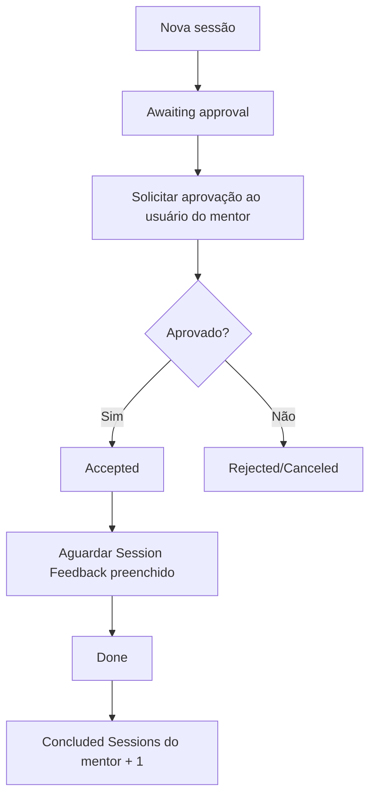

# Mentorship Program — Shark Academy

Aplicação ServiceNow para cadastrar mentores, solicitar sessões de mentoria e acompanhar sua aprovação e conclusão. Desenvolvida durante o bootcamp Shark Academy, com preferência por configurações nativas e ferramentas visuais.

**Projeto concluído em 04/11/2026 por decisão do usuário.** As quatro atividades e os extras de Mentorship Program estão encerrados, com implementação, testes registrados e documentação publicada. Exports adicionais dos dados de teste da Atividade 4 foram dispensados para o encerramento. A restauração não está planejada; a PDI antiga foi liberada. Não há ação pendente para concluir esta entrega. Os limites de preservação e os cenários não testados permanecem registrados como histórico, sem representar tarefas abertas.

O projeto Shark Academy reúne as atividades do bootcamp; este repositório é dedicado à aplicação Mentorship Program.

## O que a aplicação faz

- Cadastra mentores com usuário, biografia, área de especialidade, disponibilidade e quantidade de sessões concluídas.
- Permite selecionar somente mentores disponíveis ao cadastrar uma sessão.
- Registra data, descrição, feedback HTML, comentários e notas de trabalho.
- Controla acesso por perfis de mentor e mentorado, tanto nos registros e campos quanto no menu.
- Solicita aprovação ao usuário associado ao mentor selecionado.
- Após aprovação, aguarda o feedback, conclui a sessão e acrescenta uma unidade ao contador do mentor.
- Em caso de rejeição, encerra o caminho com a sessão em Rejected/Canceled, sem incrementar o contador.
- Permite solicitar sessões pelo Employee Center, usando um Record Producer com quatro variáveis mapeadas para a tabela de sessões.
- Restringe o acesso ao Record Producer aos grupos da aplicação e a exibição do atalho aos perfis de mentor e mentorado.
- Exige assunto, mentor e data no formulário, apresenta o feedback somente em Accepted ou Done e mostra as fases da sessão com um Process Flow Formatter.
- Impede datas anteriores ao dia atual no servidor e oferece uma mensagem junto ao campo de data no portal, preservando o restante do preenchimento.

## Atividades entregues

| Atividade | Entrega | Documentação |
|---|---|---|
| 1 — Estrutura da aplicação | Tabelas, campos, estados, formulários, listas, referências e menu tradicional | [Etapas e decisões](docs/ATIVIDADE-1-BRAZIL.md) |
| 2 — Segurança e acessos | Roles, grupos, ACLs, restrições por proprietário e visibilidade dos módulos | [Configuração e testes](docs/ATIVIDADE-2-BRAZIL.md) |
| 3 — Flow Designer | Aprovação pelo mentor, espera pelo feedback, conclusão e incremento do contador | [Fluxo e validações](docs/ATIVIDADE-3-BRAZIL.md) |
| 4 — Catálogo e portal, com extras | Record Producer, critérios de acesso, menu do Employee Center, UI Policies, fases visuais e validação de data | [Etapas, decisões e testes](docs/ATIVIDADE-4-BRAZIL.md) |

As instruções das atividades definem os requisitos. A documentação registra a implementação realizada e seus limites, sem antecipar requisitos de atividades futuras.

## Ambiente atual

| Componente | Identificação |
|---|---|
| Versão ServiceNow | Brazil |
| PDI de desenvolvimento | dev457483 |
| Aplicação | Mentorship Program |
| Escopo | `x_2273184_mentor_0` |
| Identificador da aplicação | `540f96e483945750e9c7f2d6feaad334` |
| Branch | `main` |

A aplicação foi reconstruída neste ambiente após a indisponibilidade da PDI original em Zurich. Os documentos Brazil representam a implementação atual.

## Modelo de dados

### Mentor

Tabela independente: `x_2273184_mentor_0_mentor`.

| Campo | Tipo / finalidade |
|---|---|
| Number | Identificador automático com prefixo MEN |
| Name | Referência a User (`sys_user`); valor de exibição do mentor |
| Biography | Texto de até 1.000 caracteres |
| Expertise area | Financial, Health, IT, Marketing ou Other |
| Available | Indica disponibilidade para seleção em sessões |
| Concluded Sessions | Inteiro com valor inicial 0; incrementado pelo fluxo ao concluir uma sessão aprovada |

### Mentorship Session

Tabela `x_2273184_mentor_0_mentorship_session`, extensão de **Task**. Reaproveita campos e recursos da plataforma, como identificação, abertura, descrições, comentários e notas de trabalho.

| Campo | Tipo / finalidade |
|---|---|
| Number | Identificador automático com prefixo MTS |
| Mentor's Name | Referência a Mentor, filtrada por Available = true |
| Session Date | Data e hora |
| Session Feedback | HTML, com limite configurado de 4.000 caracteres |
| State | Estados próprios da sessão, com valor inicial Draft |

| Estado | Valor |
|---|---|
| Draft | 10 |
| Awaiting approval | 20 |
| Accepted | 30 |
| Rejected/Canceled | 40 |
| Done | 50 |

As escolhas de State são específicas da tabela filha. O valor inicial foi configurado por Dictionary Override, preservando a definição geral de Task.

Relacionamentos disponíveis nos formulários: sessões vinculadas ao mentor e aprovadores vinculados à sessão.

## Segurança e navegação

Roles da aplicação:

- `x_2273184_mentor_0.mentee`: grupo **Mentorship Program - Mentorados**.
- `x_2273184_mentor_0.mentor`: grupo **Mentorship Program - Mentores**.

| Recurso | Operação | Mentorado | Mentor |
|---|---|---|---|
| Mentorship Session | Criar / consultar | Permitido | Permitido |
| Mentorship Session | Alterar | Somente sessões que criou | Permitido |
| Mentorship Session | Excluir | Não permitido | Permitido |
| Session Feedback | Preencher / alterar | Não permitido, inclusive na criação | Permitido |
| Mentor | Criar / excluir | Não permitido | Permitido |
| Mentor | Consultar | Permitido | Permitido |
| Mentor | Alterar | Não permitido | Somente seu próprio registro, identificado por Name |

A implementação possui **19 ACLs ativas**: 12 de tabela e 7 de campo. As regras específicas de campo também tratam o acesso aos campos herdados de Task. As roles e ACLs provisórias da criação inicial foram removidas.

As condições priorizam recursos declarativos. A identificação do criador da sessão usa a expressão `javascript:gs.getUserName()` no filtro; portanto, a segurança não é descrita como integralmente sem código. O detalhamento está na documentação da Atividade 2.

O menu tradicional agrupa **Mentorship Session** e **Mentor**, com módulos Create new e List. Mentor → Create new fica visível apenas ao perfil mentor. As ACLs protegem os dados independentemente da visibilidade do menu.

Os testes de restrição utilizaram Abel Tuter como mentor sem admin e Aileen Mottern como mentorada sem admin. Usuários com admin global não serviram como evidência de bloqueio, pois as ACLs configuradas permitem Admin overrides.

## Fluxo de aprovação e conclusão

**Mentorship Session — Approval and Completion**  
Identificador: `ee491b30831cd750e9c7f2d6feaad3b8`  
Publicado, ativo e executado como **System User**, conforme o enunciado.

O aprovador é obtido pelo caminho **Mentor's Name → Name**, chegando ao usuário da tabela User. O incremento usa **FX → Math → Add → 1**, sem script na construção do fluxo.

O gatilho é **Record Created**. Editar uma sessão já concluída não inicia uma nova execução desse gatilho. O ramo de rejeição não passa pela espera de feedback nem pelo incremento.

## Validação realizada

| Cenário | Resultado observado |
|---|---|
| Cadastro e referências | Mentor disponível selecionável; sessões relacionadas ao mentor |
| Segurança de mentor | Alteração do próprio cadastro permitida; cadastro de outro mentor bloqueado |
| Segurança de mentorado | Criação e alteração da própria sessão permitidas; outra sessão bloqueada para edição |
| Feedback | Bloqueado ao mentorado e permitido ao mentor |
| Navegação | Módulos exibidos conforme o perfil |
| MTS0001017 — aprovação | Requested → Approved; sessão Awaiting approval → Accepted → Done após feedback |
| Contador após conclusão | Abel passou de 0 para 1 |
| MTS0001018 — rejeição | Aprovação Rejected; sessão Rejected/Canceled; contador permaneceu em 1 |
| Feedback completo | Texto persistido após ampliar o campo HTML de 40 para 4.000 caracteres |
| MTS0001019 — Employee Center | Criação como Aileen, aprovação por Abel e estado Accepted; conclusão não confirmada |
| Acesso ao portal | Menu visível para mentor e mentorada; usuário sem grupos/roles recebeu acesso negado ao produtor e não viu o menu |
| Data inválida | Inserção e atualização bloqueadas no servidor; no portal, campo limpo e mensagem junto à data |
| Extras | Obrigatoriedade, visibilidade do feedback e fases conferidas conforme o documento da Atividade 4 |

A plataforma exigiu comentário para rejeitar a aprovação. Após informar a justificativa, o caminho de rejeição foi concluído. As mudanças automáticas de State foram observadas no histórico como realizadas por System.

## Organização do repositório

| Caminho | Conteúdo |
|---|---|
| `540f96e483945750e9c7f2d6feaad334/` | Metadados gerados pelo Source control do ServiceNow |
| `sn_source_control.properties` | Arquivo de integração gerado pelo ServiceNow |
| `docs/` | Documentação das atividades, decisões e testes |
| [Dados atuais — Atividade 3](exports/mentorship-program/brazil/data/atividade-3-2026-10-30/) | 4 mentores, 4 sessões, 2 aprovações e 8 journals incorporados aos XMLs |
| [Grupos e atribuições](exports/mentorship-program/brazil/groups/) | 2 grupos, 2 atribuições de roles e 5 membros, exportados na Atividade 2 |
| [Layout Global de Approvers](exports/mentorship-program/brazil/global-approvers/) | Configuração complementar da lista relacionada |
| [Exportações anteriores](exports/mentorship-program/brazil/data/) | Marcos históricos das Atividades 1 e 2 e seus READMEs |

Os dados da Atividade 3 são o marco mais recente de mentores, sessões e aprovações. Os XMLs anteriores permanecem como histórico; seus contadores e estados refletem a época de cada exportação.

## Preservação e recuperação

**Source control preserva configurações; os XMLs complementares preservam os dados exportados.** Documentos e XMLs de dados não viram registros automaticamente por Pull from repository.

Referência para uma eventual recuperação futura, caso seja necessária:

1. Importar a aplicação pelo Source control e conferir suas dependências.
2. Conferir os usuários referenciados, pois seus cadastros não estão incluídos nas exportações.
3. Planejar a importação considerando que um fluxo ativo pode reagir à criação de sessões.
4. Restaurar mentores antes das sessões e aprovações; tratar grupos, atribuições e layout Global separadamente.
5. Consultar os READMEs dos XMLs e validar permissões, vínculos e automação no ambiente de destino.

**A restauração em outra PDI não foi testada e não está planejada, por decisão do usuário.** A PDI antiga dev435099 (Zurich) foi liberada pelo usuário; não há recuperação dessa instância pendente. As exportações não representam um backup integral da instância: credenciais, usuários, auditoria completa e contextos de execução do fluxo não estão incluídos.

Marcos recentes:

- [Configuração da Atividade 3](https://github.com/fredsons/mentorship-program/commit/40346b001294a112f3b2dbfbe4cfc009a2a4a268): fluxo e ampliação do feedback HTML.
- [Fechamento e dados da Atividade 3](https://github.com/fredsons/mentorship-program/commit/5406740503121da129f4ad644711adcb1bc5a10b): documentação e exportações complementares.

## Continuidade do desenvolvimento

Alterações feitas na PDI precisam de novos commits pelo **Source control → Commit changes**. Depois de alterações feitas diretamente neste repositório, executar **Source control → Pull from repository** na aplicação antes de continuar o desenvolvimento, preservando eventuais alterações locais.

Os testes atuais cobrem os caminhos funcionais descritos. Concorrência entre conclusões simultâneas, alteração do mentor durante uma execução, conteúdo HTML composto apenas por marcações vazias e chamadas por API não foram validados. Novas atividades serão incorporadas conforme seus enunciados forem disponibilizados.

## Atualização documental — Atividade 4 e extras (01/11/2026)

A Atividade 4 acrescenta o Record Producer de sessões de mentoria e seu acesso pelo Employee Center. Os extras incluem obrigatoriedade por UI Policy, feedback visível em Accepted ou Done, indicador visual das etapas e validação de datas na plataforma e no portal.

Consulte [Atividade 4 e extras — configuração, decisões e testes](docs/ATIVIDADE-4-BRAZIL.md) para os passos e as evidências. Foram observados a criação pelo portal, a solicitação de aprovação, o aceite e os testes de acesso e validação. A sessão MTS0001019 chegou a Accepted; sua conclusão e incremento do contador não estão comprovados nesta etapa.

O usuário confirmou a preservação das configurações. Commits conferidos: Atividade 4 `2f66b9616445d6c4d664b5a41c691f8686f43599`, extras `dbe11f71cb27956a14dc401c54eaae29a1d8d768` e melhoria da data `227e9bb575a97ce016c5f66c6cf3cc369946c670`. Os exports adicionais dos dados de teste da Atividade 4 foram dispensados pelo usuário no encerramento. Arquivos de documentação e exports não são carregados na instância pelo Pull do source control.

## Fontes, histórico e encerramento

- [Inventário de fontes](docs/FONTES.md): enunciados das quatro atividades, slides e documentação oficial.
- [Marcos de versionamento](docs/VERSIONAMENTO.md): commits e limites de preservação.
- [Implementação histórica Zurich](docs/HISTORICO-ZURICH.md): referência anterior, com identificadores próprios.

Não há pendências de encerramento. O usuário dispensou exports adicionais dos dados de teste; a restauração também não integra o escopo. Os dados publicados da Atividade 3 não comprovam a preservação dos dados da Atividade 4. Não há nova auditoria da PDI nesta revisão documental.
