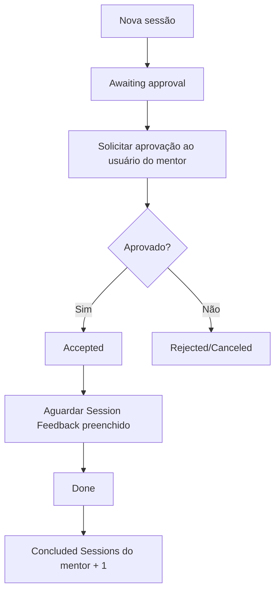

# Mentorship Program — Shark Academy

Aplicação ServiceNow para cadastrar mentores, solicitar sessões de mentoria e acompanhar sua aprovação e conclusão. Desenvolvida durante o bootcamp Shark Academy, com preferência por configurações nativas e ferramentas visuais.

**Estado em 31/10/2026:** Atividades 1, 2 e 3 concluídas, com testes funcionais observados e arquivos preservados neste repositório. A Atividade 4 (Record Producer, acesso por grupos e menu no portal) está implementada, mas ainda não tem documento em `docs/` nem testes registrados. Uma possível atividade da última aula ainda depende da divulgação do enunciado.

O projeto Shark Academy reúne as atividades do bootcamp; este repositório é dedicado à aplicação Mentorship Program.

## O que a aplicação faz

- Cadastra mentores com usuário, biografia, área de especialidade, disponibilidade e quantidade de sessões concluídas.
- Permite selecionar somente mentores disponíveis ao cadastrar uma sessão.
- Registra data, descrição, feedback HTML, comentários e notas de trabalho.
- Controla acesso por perfis de mentor e mentorado, tanto nos registros e campos quanto no menu.
- Solicita aprovação ao usuário associado ao mentor selecionado.
- Após aprovação, aguarda o feedback, conclui a sessão e acrescenta uma unidade ao contador do mentor.
- Em caso de rejeição, encerra o caminho com a sessão em Rejected/Canceled, sem incrementar o contador.
- Permite solicitar uma sessão pelo portal, com um Record Producer restrito aos grupos da aplicação.
- Impede datas de sessão anteriores a hoje, tanto no formulário da plataforma quanto no portal.

## Atividades entregues

| Atividade | Entrega | Documentação |
|---|---|---|
| 1 — Estrutura da aplicação | Tabelas, campos, estados, formulários, listas, referências e menu tradicional | [Etapas e decisões](docs/ATIVIDADE-1-BRAZIL.md) |
| 2 — Segurança e acessos | Roles, grupos, ACLs, restrições por proprietário e visibilidade dos módulos | [Configuração e testes](docs/ATIVIDADE-2-BRAZIL.md) |
| 3 — Flow Designer | Aprovação pelo mentor, espera pelo feedback, conclusão e incremento do contador | [Fluxo e validações](docs/ATIVIDADE-3-BRAZIL.md) |
| 4 — Portal | Record Producer, acesso por grupos e item de menu no portal | A documentar (ver [Portal e Record Producer](#portal-e-record-producer)) |

As instruções das atividades definem os requisitos. A documentação registra a implementação realizada e seus limites, sem antecipar requisitos de atividades futuras.

## Ambiente atual

| Componente | Identificação |
|---|---|
| Versão ServiceNow | Brazil |
| PDI de desenvolvimento | dev457483 |
| Aplicação | Mentorship Program |
| Escopo | `x_2273184_mentor_0` |
| Identificador da aplicação | `540f96e483945750e9c7f2d6feaad334` |
| Branch | `main` |

A aplicação foi reconstruída neste ambiente após a indisponibilidade da PDI original em Zurich. Os documentos Brazil representam a implementação atual.

## Modelo de dados

### Mentor

Tabela independente: `x_2273184_mentor_0_mentor`.

| Campo | Tipo / finalidade |
|---|---|
| Number | Identificador automático com prefixo MEN |
| Name | Referência a User (`sys_user`); valor de exibição do mentor |
| Biography | Texto de até 1.000 caracteres |
| Expertise area | Financial, Health, IT, Marketing ou Other |
| Available | Indica disponibilidade para seleção em sessões |
| Concluded Sessions | Inteiro com valor inicial 0; incrementado pelo fluxo ao concluir uma sessão aprovada |

### Mentorship Session

Tabela `x_2273184_mentor_0_mentorship_session`, extensão de **Task**. Reaproveita campos e recursos da plataforma, como identificação, abertura, descrições, comentários e notas de trabalho.

| Campo | Tipo / finalidade |
|---|---|
| Number | Identificador automático com prefixo MTS |
| Mentor's Name | Referência a Mentor, filtrada por Available = true |
| Session Date | Data e hora |
| Session Feedback | HTML, com limite configurado de 4.000 caracteres |
| State | Estados próprios da sessão, com valor inicial Draft |

| Estado | Valor |
|---|---|
| Draft | 10 |
| Awaiting approval | 20 |
| Accepted | 30 |
| Rejected/Canceled | 40 |
| Done | 50 |

As escolhas de State são específicas da tabela filha. O valor inicial foi configurado por Dictionary Override, preservando a definição geral de Task.

Relacionamentos disponíveis nos formulários: sessões vinculadas ao mentor e aprovadores vinculados à sessão.

## Segurança e navegação

Roles da aplicação:

- `x_2273184_mentor_0.mentee`: grupo **Mentorship Program - Mentorados**.
- `x_2273184_mentor_0.mentor`: grupo **Mentorship Program - Mentores**.

| Recurso | Operação | Mentorado | Mentor |
|---|---|---|---|
| Mentorship Session | Criar / consultar | Permitido | Permitido |
| Mentorship Session | Alterar | Somente sessões que criou | Permitido |
| Mentorship Session | Excluir | Não permitido | Permitido |
| Session Feedback | Preencher / alterar | Não permitido, inclusive na criação | Permitido |
| Mentor | Criar / excluir | Não permitido | Permitido |
| Mentor | Consultar | Permitido | Permitido |
| Mentor | Alterar | Não permitido | Somente seu próprio registro, identificado por Name |

A implementação possui **19 ACLs ativas**: 12 de tabela e 7 de campo. As regras específicas de campo também tratam o acesso aos campos herdados de Task. As roles e ACLs provisórias da criação inicial foram removidas.

As condições priorizam recursos declarativos. A identificação do criador da sessão usa a expressão `javascript:gs.getUserName()` no filtro; portanto, a segurança não é descrita como integralmente sem código. O detalhamento está na documentação da Atividade 2.

O menu tradicional agrupa **Mentorship Session** e **Mentor**, com módulos Create new e List. Mentor → Create new fica visível apenas ao perfil mentor. As ACLs protegem os dados independentemente da visibilidade do menu.

Os testes de restrição utilizaram Abel Tuter como mentor sem admin e Aileen Mottern como mentorada sem admin. Usuários com admin global não serviram como evidência de bloqueio, pois as ACLs configuradas permitem Admin overrides.

## Fluxo de aprovação e conclusão

**Mentorship Session — Approval and Completion**  
Identificador: `ee491b30831cd750e9c7f2d6feaad3b8`  
Publicado, ativo e executado como **System User**, conforme o enunciado.

O aprovador é obtido pelo caminho **Mentor's Name → Name**, chegando ao usuário da tabela User. O incremento usa **FX → Math → Add → 1**, sem script na construção do fluxo.

O gatilho é **Record Created**. Editar uma sessão já concluída não inicia uma nova execução desse gatilho. O ramo de rejeição não passa pela espera de feedback nem pelo incremento.

## Portal e Record Producer

Implementado na Atividade 4 (commit [2f66b96](https://github.com/fredsons/mentorship-program/commit/2f66b96)). Ainda não há documento em `docs/` nem testes registrados para esta parte.

**Mentorship Session** (Record Producer, ativo) cria registros na tabela Mentorship Session. Descrição exibida: "Request here your mentorship session!".

| Ordem | Pergunta | Campo de destino | Tipo | Obrigatória |
|---|---|---|---|---|
| 100 | What's your session subject? | `short_description` | Texto de uma linha | Sim |
| 200 | Describe your needs for this session | `description` | Texto de várias linhas | Não |
| 300 | When would you like to schedule your session? | `session_date` | Data e hora | Sim |
| 400 | Choose your mentor | `mentors_name` | Referência a Mentor, filtrada por Available = true | Sim |

- **Acesso:** o item usa o User Criteria **Mentorship Program Users**, que reconhece os grupos *Mentorship Program - Mentorados* e *Mentorship Program - Mentores* (basta pertencer a um deles).
- **Menu:** item **New Mentorship Session** no portal, apontando para o Record Producer.
- O script do Record Producer é o modelo padrão da plataforma, sem lógica adicional.

## Validações e ajustes de formulário

| Recurso | O que faz |
|---|---|
| Business Rule **Impedir data de sessão anterior a hoje.** | Executa antes de inserir ou atualizar. Aborta a gravação quando Session Date é anterior ao início de hoje e o campo foi alterado, e exibe "A data da sessão não pode ser anterior a hoje." A lógica está na condição de filtro; o script está vazio. |
| Catalog UI Policy **Validar data da sessão no portal** | No portal, mostra a mesma mensagem de erro no campo de data quando ele é anterior a hoje, antes do envio. Sem script. |
| UI Policy **Obrigatoriedade dos campos da sessão** | Torna Short description, Mentor's Name e Session Date obrigatórios no formulário da plataforma. |
| UI Policy **Exibir feedback em sessões aceitas ou concluídas** | Mostra Session Feedback somente quando State é Accepted ou Done. |
| Process Flow no formulário | Barra de fases: Draft → Awaiting approval → Accepted → Done, com Rejected/Canceled como desfecho alternativo. |

A regra de negócio vale para qualquer origem de gravação, inclusive o portal, e a Catalog UI Policy é apenas o aviso antecipado no portal. Os testes dessas validações ainda não estão documentados.

## Validação realizada

| Cenário | Resultado observado |
|---|---|
| Cadastro e referências | Mentor disponível selecionável; sessões relacionadas ao mentor |
| Segurança de mentor | Alteração do próprio cadastro permitida; cadastro de outro mentor bloqueado |
| Segurança de mentorado | Criação e alteração da própria sessão permitidas; outra sessão bloqueada para edição |
| Feedback | Bloqueado ao mentorado e permitido ao mentor |
| Navegação | Módulos exibidos conforme o perfil |
| MTS0001017 — aprovação | Requested → Approved; sessão Awaiting approval → Accepted → Done após feedback |
| Contador após conclusão | Abel passou de 0 para 1 |
| MTS0001018 — rejeição | Aprovação Rejected; sessão Rejected/Canceled; contador permaneceu em 1 |
| Feedback completo | Texto persistido após ampliar o campo HTML de 40 para 4.000 caracteres |

A plataforma exigiu comentário para rejeitar a aprovação. Após informar a justificativa, o caminho de rejeição foi concluído. As mudanças automáticas de State foram observadas no histórico como realizadas por System.

## Organização do repositório

| Caminho | Conteúdo |
|---|---|
| `540f96e483945750e9c7f2d6feaad334/` | Metadados gerados pelo Source control do ServiceNow |
| `sn_source_control.properties` | Arquivo de integração gerado pelo ServiceNow |
| `docs/` | Documentação das atividades, decisões e testes |
| [Dados atuais — Atividade 3](exports/mentorship-program/brazil/data/atividade-3-2026-10-30/) | 4 mentores, 4 sessões, 2 aprovações e 8 journals incorporados aos XMLs |
| [Grupos e atribuições](exports/mentorship-program/brazil/groups/) | 2 grupos, 2 atribuições de roles e 5 membros, exportados na Atividade 2 |
| [Layout Global de Approvers](exports/mentorship-program/brazil/global-approvers/) | Configuração complementar da lista relacionada |
| [Exportações anteriores](exports/mentorship-program/brazil/data/) | Marcos históricos das Atividades 1 e 2 e seus READMEs |

Os dados da Atividade 3 são o marco mais recente de mentores, sessões e aprovações. Os XMLs anteriores permanecem como histórico; seus contadores e estados refletem a época de cada exportação.

## Preservação e recuperação

**Source control preserva configurações; os XMLs complementares preservam os dados exportados.** Documentos e XMLs de dados não viram registros automaticamente por Pull from repository.

Para preparar uma recuperação:

1. Importar a aplicação pelo Source control e conferir suas dependências.
2. Conferir os usuários referenciados, pois seus cadastros não estão incluídos nas exportações.
3. Planejar a importação considerando que um fluxo ativo pode reagir à criação de sessões.
4. Restaurar mentores antes das sessões e aprovações; tratar grupos, atribuições e layout Global separadamente.
5. Consultar os READMEs dos XMLs e validar permissões, vínculos e automação no ambiente de destino.

**A restauração em outra PDI ainda não foi testada.** As exportações não representam um backup integral da instância: credenciais, usuários, auditoria completa e contextos de execução do fluxo não estão incluídos.

Marcos recentes:

- [Configuração da Atividade 3](https://github.com/fredsons/mentorship-program/commit/40346b001294a112f3b2dbfbe4cfc009a2a4a268): fluxo e ampliação do feedback HTML.
- [Fechamento e dados da Atividade 3](https://github.com/fredsons/mentorship-program/commit/5406740503121da129f4ad644711adcb1bc5a10b): documentação e exportações complementares.

## Continuidade do desenvolvimento

Alterações feitas na PDI precisam de novos commits pelo **Source control → Commit changes**. Depois de alterações feitas diretamente neste repositório, executar **Source control → Pull from repository** na aplicação antes de continuar o desenvolvimento, preservando eventuais alterações locais.

Os testes atuais cobrem os caminhos funcionais das Atividades 1 a 3; portal e validações de data ainda não foram documentados. Concorrência entre conclusões simultâneas, alteração do mentor durante uma execução, conteúdo HTML composto apenas por marcações vazias e chamadas por API não foram validados. Novas atividades serão incorporadas conforme seus enunciados forem disponibilizados.
